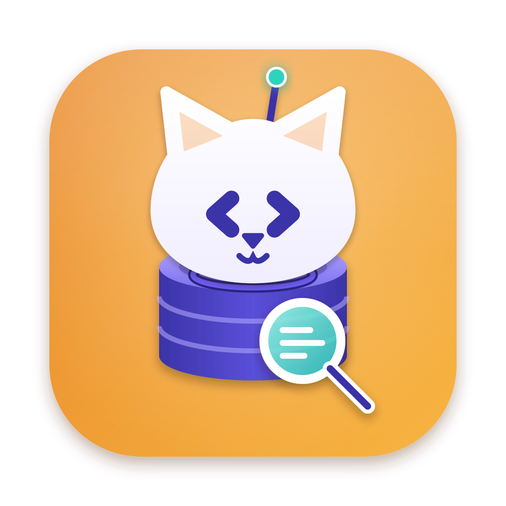

<p align="center"></p>

<h1 align="center">DBCatz</h1>
<p align="center"><em>Curiosity won't kill this cat.</em></p>
<p align="center">
  <a href="https://catzoid.com/dbcatz">Website</a> ·
  <a href="https://catzoid.com/dbcatz/download">Download</a> ·
  <a href="https://catzoid.com/docs">Docs</a> ·
  <a href="https://catzoid.com/community">Community</a>
</p>

A database client for macOS: MySQL, MariaDB, PostgreSQL, SQLite, Redis, Valkey, MongoDB and Elasticsearch in one window, a tab per connection — local servers, through SSH, on AWS with IAM, or with credentials from Vault. Production mode asks before every write, read-only stays read-only, and an optional AI writes the query while you press Run.

Part of [Catzoid](https://catzoid.com) — free, open-source developer tools with nine lives. All cats, no catch: no
account, no Pro tier, nothing locked behind a payment.

## What it does

- **Connect** by hand, over SSH, with AWS IAM or Vault — or paste a URL (`postgres://…`, a whole `DATABASE_URL=` line works too). Passwords stay in the macOS Keychain.
- **Browse and edit** — data grid with filters, structure, indexes, export and import, a query editor with history.
- **Production safety** — Production and Read-only modes per connection, typed confirmations for risky statements.
- **AI, optional** — Ask in plain words; only structure is sent, never your rows unless you allow samples.
- **The family** — databases [DevCatz](https://github.com/catzoidhub/DevCatz) runs show up by themselves; [DialCatz](https://github.com/catzoidhub/DialCatz) opens the table a request touched.

## Install

Download the DMG from [catzoid.com/dbcatz/download](https://catzoid.com/dbcatz/download) — it picks the right
build for your Mac (Apple silicon or Intel, macOS 13 or later). Or with Homebrew — it asks you to trust a tap
that is not its own the first time:

```bash
brew tap catzoidhub/catz && brew trust catzoidhub/catz
brew install --cask dbcatz
```

The app is signed and notarized by Apple and updates itself (Settings → About → Check for Updates). Windows builds
are on the way.

## Build from source

```bash
bun install
bun run dev          # run it in development
bun run typecheck
bun run package      # a signed DMG in dist/ (notarized when a notarytool profile is set up)
```

Found a bug? Use **Help → Report a Bug…** in the app, or [open an issue](https://github.com/catzoidhub/DBCatz/issues).

## Licence

DBCatz is free software: you can redistribute it and/or modify it under the terms of the GNU General Public License
as published by the Free Software Foundation, version 3. It comes with no warranty. See [`LICENSE`](LICENSE).

The names Catzoid and DBCatz and the Catzoid cat are trademarks and are **not** covered by the licence: a fork must
use its own name and icon. See [`TRADEMARKS.md`](TRADEMARKS.md).

Contributions are welcome — see [`CONTRIBUTING.md`](CONTRIBUTING.md). Before your first pull request is merged you
sign the [contributor licence agreement](CLA.md) through the CLA check on the pull request — you keep the copyright of
your work. Questions and bug reports: [`SUPPORT.md`](SUPPORT.md); security problems, privately: [`SECURITY.md`](SECURITY.md).

Copyright © 2026 Mahryan Rakhmatullah
